# Brand mark: pretzel + "ESN MESA"

The app's brand mark (`components/BrandMark.tsx`) is the section's coloured
pretzel followed by an "ESN MESA" wordmark. It replaced the ESN star, which
in turn had replaced the PNG section logo (`public/esn-mesa-logo.png`) whose
small type was unreadable in the header.

## Files

| File | What |
| --- | --- |
| `pretzel-color.svg` | The original pretzel (2200×1823, 37 paths in #00AEEF, #7AC143, #EC008C, #F47B20). Keep unchanged. |
| `../public/pretzel.svg` | Optimised copy for the app: SVGO 4 (`floatPrecision: 1`, i.e. 0.1 units on a 2200-unit canvas), then the paths merged into one path per colour (the tiles never overlap, so this is lossless). 14.1 kB → 7.8 kB, 4 paths. |
| `../scripts/gen-icons.mjs` | `npm run gen:icons`: `app/icon.svg`, `app/favicon.ico` (16/32/48) and `app/apple-icon.png` (180) from `public/pretzel.svg`. |
| `wordmark-options.html` | The six wordmark variants in the header (desktop, 375 px) and on the login card. Open it directly in a browser. Generated by `gen-wordmark-options.mjs`. |
| `shoot-wordmark-options.mjs` | Screenshots of every variant (`screenshots/<variant>-*.png`, `wordmark-options-full.png`). |
| `fonts/` | The fonts of the variants (Figtree, Nunito, Outfit; latin, variable weight), from Fontsource 5.3.0, all SIL Open Font License 1.1. |

To redo the optimised SVG:

```bash
npx -y svgo@4 --config svgo.config.mjs -i design/pretzel-color.svg -o public/pretzel.svg
```

with `export default { multipass: true, floatPrecision: 1, plugins: [{ name: "preset-default", params: { overrides: { mergePaths: { force: true } } } }, "removeDimensions"] }`,
then join the `d` attributes of paths with the same fill (SVGO only merges
neighbouring paths), and run `npm run gen:icons`.

## The pretzel on the dark blue header

All four colours stay clear on #2E3192 (orange, green and cyan strongly;
magenta, the weakest, still separates from the blue at about 2.4:1 and is
always next to other tiles), and the gaps between the tiles simply show the
header colour. So there is **no white backing**: it would turn the mark into a
sticker and make it look smaller. Sizes: 40 px tall in the header (36 px
below 640 px width), 60 px on the login card; about twice the cap height of
the lettering, so the busy mosaic doesn't overpower the text.

## Tab icons

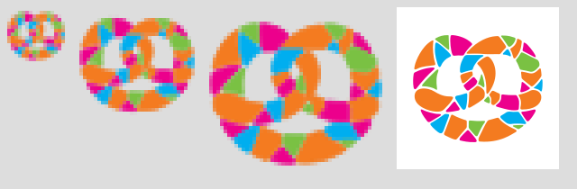

- `app/icon.svg`: the pretzel on a square canvas. At 16–32 px the thin gaps
  between the tiles only blur into grey, so each tile is stroked in its own
  colour (32 units), which closes the gaps: one solid pretzel with its three
  holes still open.
- `app/favicon.ico`: the same at 16, 32 and 48 px (PNG entries) for browsers
  that ask for `/favicon.ico`.
- `app/apple-icon.png`: 180×180, opaque white (iOS shows transparency as
  black), the pretzel with its gaps 144 px wide (80 %), clear of the rounded
  corners iOS cuts.
- Removed: `app/icon.png` (the old 512 px section logo icon). `proxy.ts`
  skips `icon.svg` and `pretzel.svg` like the other static icons, so the
  login page can show them before sign-in.

## Wordmark variants

All at about the old logo's "ESN" letter height: 28 px type, a 20 px cap
height in the 64 px header (26 px type below 640 px width so the mark, the
avatar and "Sign out" fit at 375 px). The capitals are vertically centred on
the pretzel with `text-box: trim-both cap alphabetic`.
[Full comparison](wordmark-options-full.png).

| | Header | 375 px | Login card |
| --- | --- | --- | --- |
| **A · Figtree 600, as now.** One weight, one colour. Calm and closest to the old "ESN", but flat: nothing tells ESN and MESA apart. | 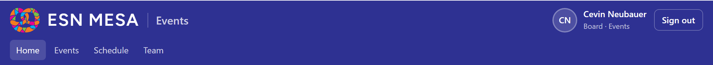 | 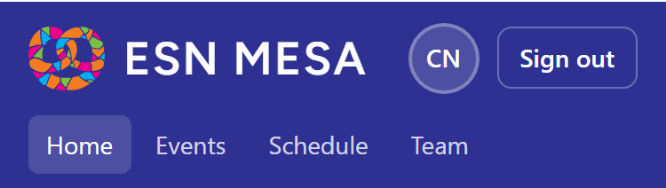 | 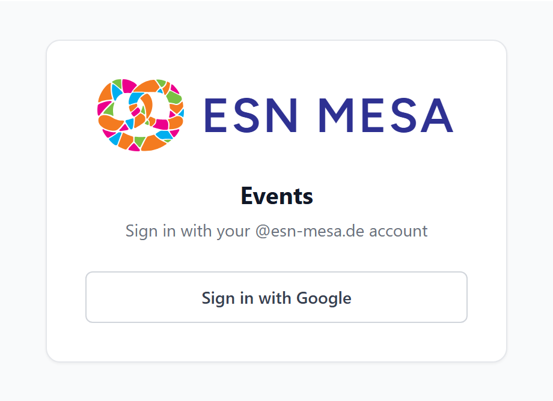 |
| **B · Weight contrast** (chosen). Figtree ExtraBold "ESN", Regular "MESA". | 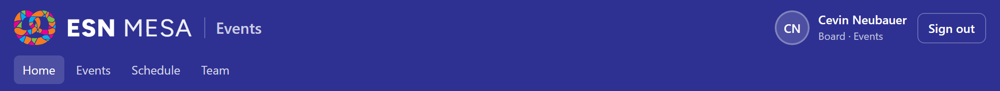 | 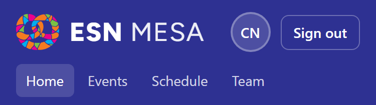 | 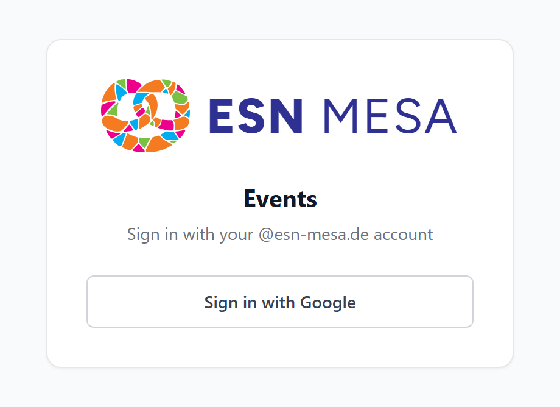 |
| **C · Colour contrast.** Figtree 700, "MESA" in the pretzel's orange. Ties text to mark, but one more colour block next to a busy mark; orange on white is weak (2.9:1). | 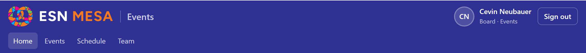 | 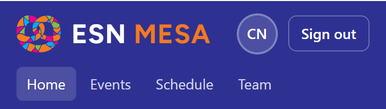 | 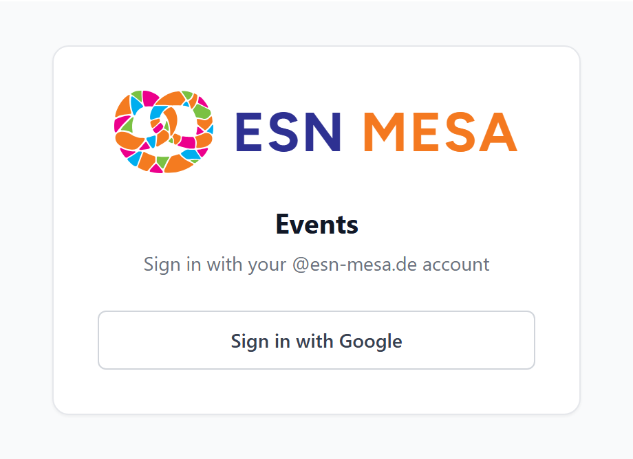 |
| **D · Stacked.** "ESN" over a widely spaced "MESA", "Events" as a pill. Narrow, but "MESA" shrinks to 11 px: the old logo's problem. | 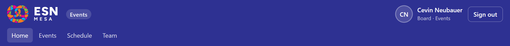 | 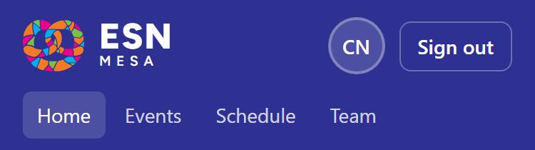 | 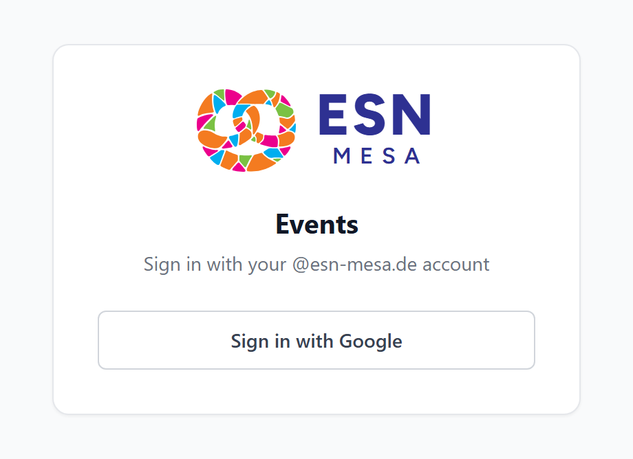 |
| **E · Rounded, Nunito 800.** Rounded terminals echo the rounded tiles. Friendly, but heavy and further from ESN's geometric lettering. | 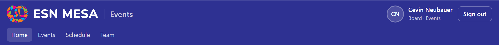 | 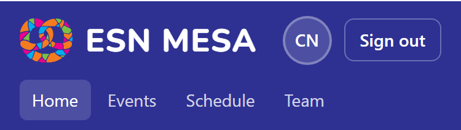 | 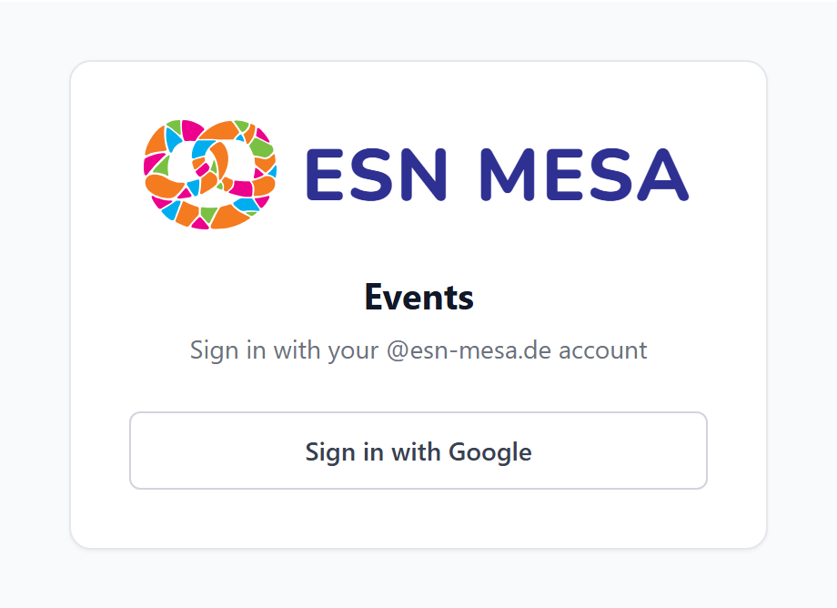 |
| **F · Outfit 600.** Crisp geometric sans. Modern, but further from the old "ESN". | 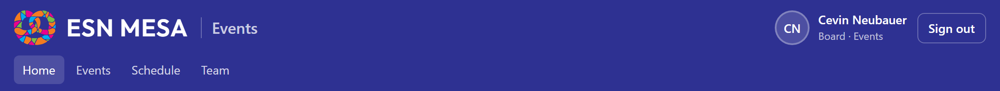 | 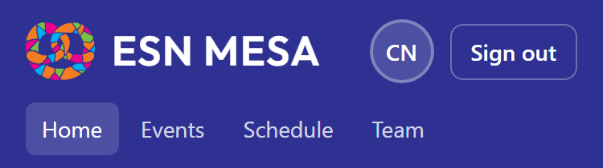 | 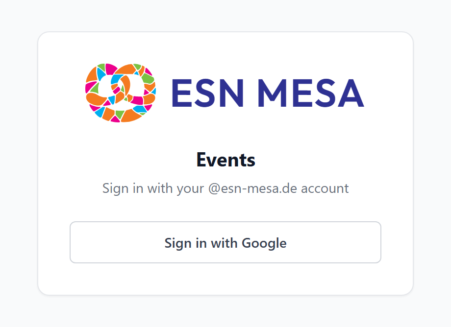 |

### Chosen: B

- **Hierarchy without colour.** "ESN" (the network) bold, "MESA" (the
  section) light: the name reads as two words even at a glance, and the
  pretzel stays the only colourful element.
- **Continuity.** Same family as before (Figtree, the closest free match to
  the old logo's "ESN"), same letter height; just a weight change.
- **Weight balance.** The ExtraBold "ESN" holds its own next to the dense
  mosaic; the Regular "MESA" keeps the mark from turning into a heavy block.
  On the dark header "MESA" is 90 % white, so the two words differ in weight
  only, not in brightness.
- Fits at 375 px (about 190 px wide), and on the login card.

To switch to another variant, change the classes of the wordmark `<span>` in
`BrandMark.tsx` (sizes and font loading stay the same; for E or F copy the font
from `fonts/` to `components/fonts/` and load it with `next/font/local`).

## In the app (variant B)

| | Desktop | 375 px |
| --- | --- | --- |
| Header | 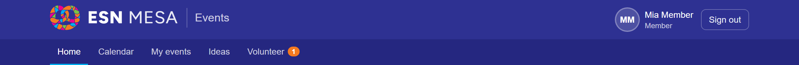 | 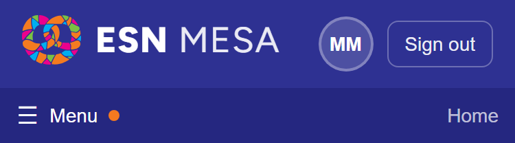 |
| Login |  | 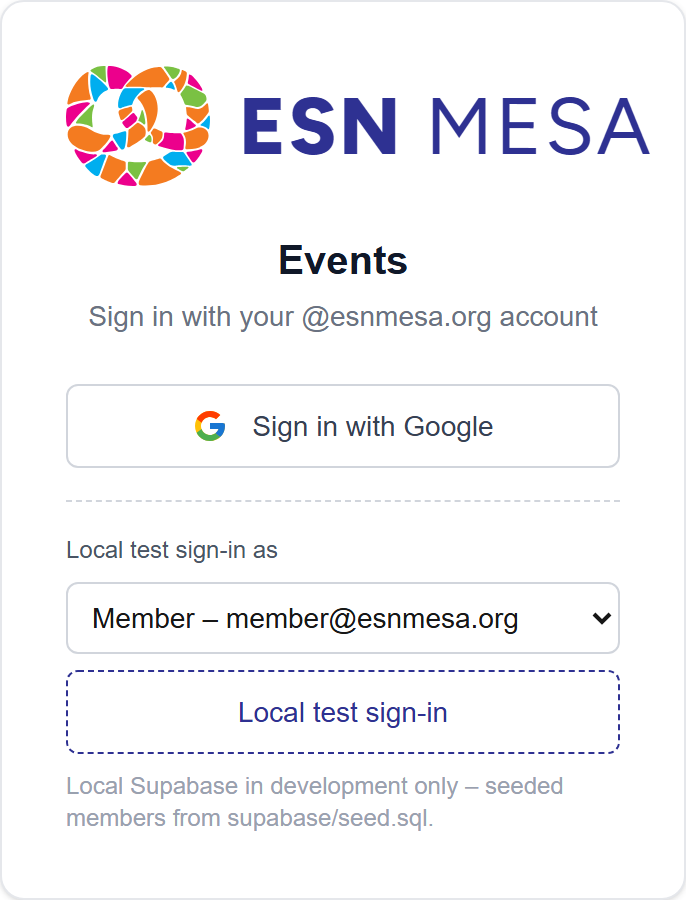 |
| Public attendance form | 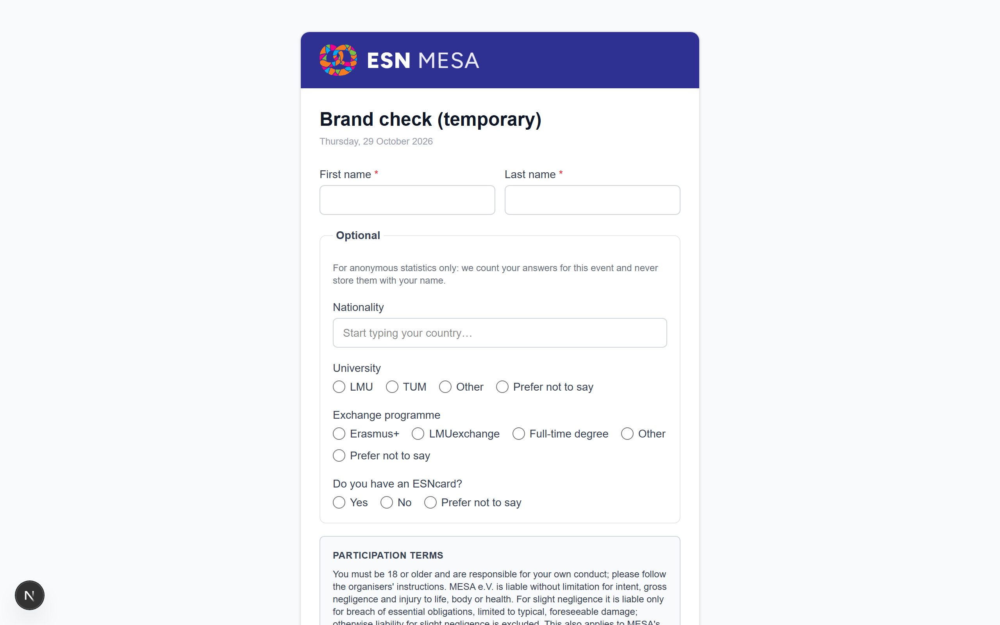 | 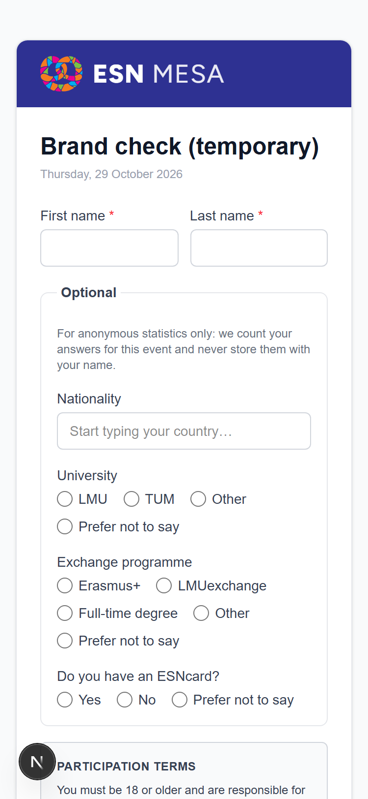 |
| Not found | | 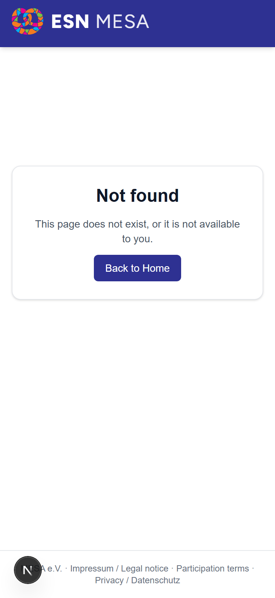 |

Checked on 2026-10-29 at 1280 and 375 px: no horizontal scroll on any of these
pages.
